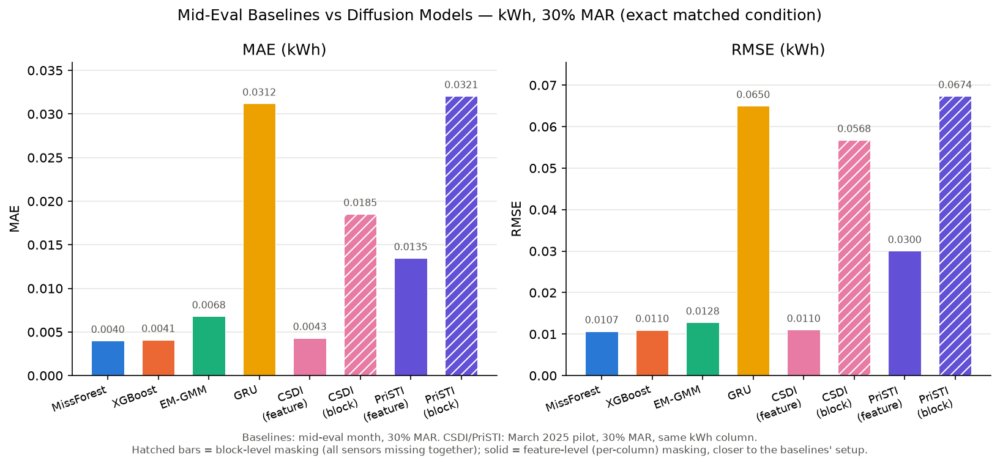

# Smart-Meter Data Imputation — A Comparative Study

**B.Tech project (P51), Electrical Engineering, IIT Indore**
Dara Nissi Krithika · Guided by Prof. Trapti Jain · Co-supervised by Dr. Puneet Gupta

A controlled comparison of **statistical, machine-learning, deep-learning and diffusion-based** methods for
recovering missing values in real smart-meter electricity data from Indore (1,350 domestic meters,
15-minute resolution, Aug 2024 – Jul 2025).

> This repository contains the **documentation and result summaries** only.
> The implementation is kept in a private repository.

## Problem

Smart meters lose readings to communication failures and sensor faults. In this dataset the loss is
**block-structured**: Voltage, Current, kWh, kVAh and Neutral Current all go missing together for a meter-timeslot,
and meters often miss entire days (37 % missing in Mar 2025, up to 74 % in Oct 2024). The task is to reconstruct
those five variables accurately, with physically valid values.

## Methods compared

| Family | Methods |
|---|---|
| Statistical | MICE-PMM, EM-GMM, EM-LogNormal, Seasonal Kalman, LRTC |
| Machine learning | MissForest, XGBoost |
| Deep learning | LSTM, Bi-GRU, ResNet |
| Diffusion | **CSDI** (Tashiro et al., NeurIPS 2021), **PriSTI** (Liu et al., ICDE 2023) |

## Experimental design

- Missingness rates: 10, 30, 50, 70, 90 %
- Mechanisms: MCAR, MAR, MNAR
- Masking styles: feature-level and block-level (30 conditions)
- Metrics: MAE, MSE, RMSE, MAPE, CRPS (probabilistic)
- Input: one meter-day as a `(96, 5)` window — 96 fifteen-minute slots x 5 sensors
- Physics post-processing before scoring: non-negative currents and energy, 180–285 V voltage range, kWh <= kVAh

**Scope note:** the 10–90 % grid and 30 conditions apply to the diffusion phase (CSDI, PriSTI), run on the March 2025 pilot month. The statistical/ML/DL baselines from the mid-evaluation were tested at 10–40 % missingness on single months; the 30 % MAR kWh comparison below is the one condition where both overlap exactly.

## Headline result (kWh, 30 % MAR, March 2025)

| Method | Family | MAE | RMSE | MAPE (%) |
|---|---|---|---|---|
| MissForest | ML | 0.0040 | 0.0107 | 24.16 |
| XGBoost | ML | 0.0041 | 0.0110 | 25.06 |
| EM-GMM | Statistical | 0.0068 | 0.0128 | 11.44 |
| GRU | DL | 0.0312 | 0.0650 | 30.33 |
| **CSDI** (feature-level) | Diffusion | 0.0043 | 0.0110 | **8.63** |
| PriSTI (feature-level) | Diffusion | 0.0135 | 0.0300 | 22.61 |

CSDI matches the best ML baselines on MAE/RMSE, has the lowest MAPE, and additionally returns full predictive
distributions (CRPS), which the baselines cannot. Block-level masking, which mirrors the real missingness,
is noticeably harder for all diffusion models.

## Contents

| Path | What it is |
|---|---|
| [docs/P51_mid_eval_report.pdf](docs/P51_mid_eval_report.pdf) | Mid-evaluation report: statistical, ML and DL baselines |
| [docs/DIFFUSION_MODELS_GUIDE.md](docs/DIFFUSION_MODELS_GUIDE.md) | Plain-language guide to how CSDI and PriSTI work, and the design decisions made |
| [docs/literature_review.md](docs/literature_review.md) | Literature review |
| [docs/missingness_mechanisms.jpeg](docs/missingness_mechanisms.jpeg) | MCAR / MAR / MNAR definitions used |
| [results/comparison_report.md](results/comparison_report.md) | Full diffusion-vs-baseline comparison and analysis |
| [results/figures/](results/figures) | Result plots (error vs missingness rate, heatmaps, CRPS, training curves) |
| [results/tables/](results/tables) | Summary result tables (CSV) |

## Data

The meter data is not public and is not included.
